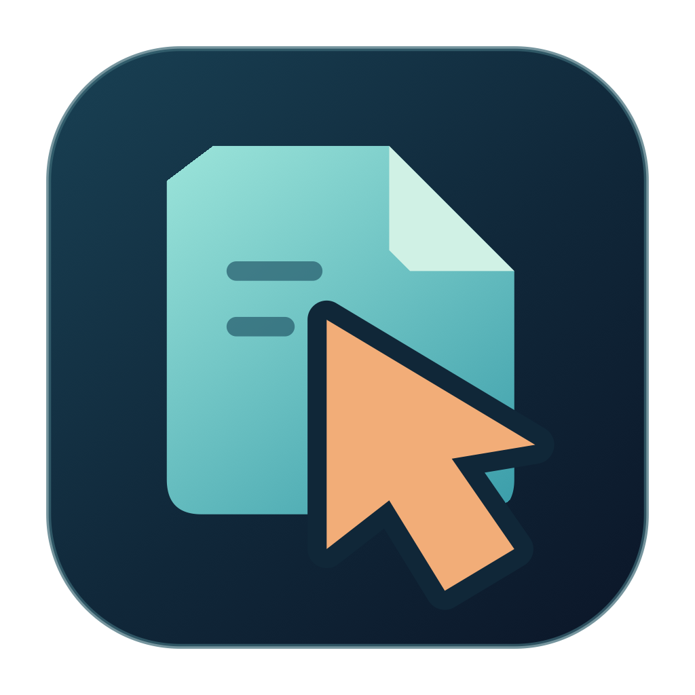
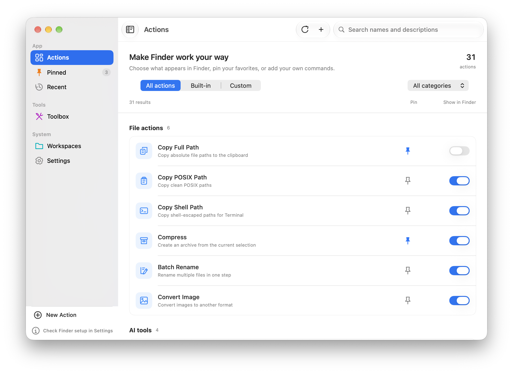
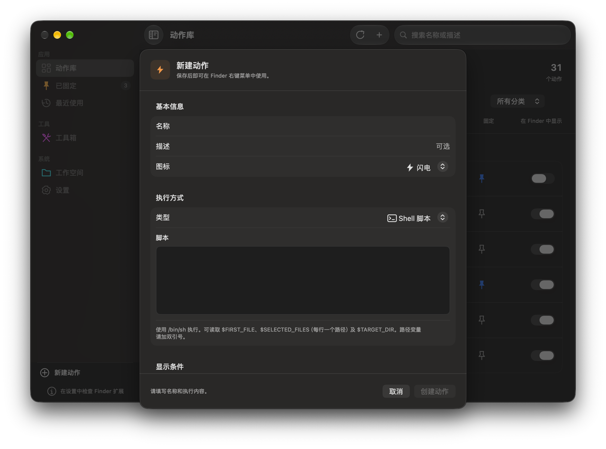

<p align="center">
  
</p>

<h1 align="center">Super RClick</h1>

<p align="center">
  Native macOS Finder right-click tools. Rename, compress, create files and build your own menu actions.<br>
  原生 Mac 右键助手：批量重命名、压缩、新建文件、图片转换与自定义动作。
</p>

<p align="center">
  <a href="https://github.com/CalvinQin/SuperRClick/releases/tag/v0.3.0-beta.1">Download 0.3.0 Preview</a> ·
  <a href="https://calvinqin.github.io/SuperRClick/">Website</a> ·
  <a href="https://calvinqin.github.io/SuperRClick/zh/">中文官网与安装说明</a> ·
  <a href="https://github.com/CalvinQin/SuperRClick/issues">Report a problem</a>
</p>

## 0.3.0 Community Preview

The October 24, 2026 preview brings a native action library and editor, original icons, safer file outputs, corrected macOS deployment targets and a four-step setup guide.

**This is a GitHub preview, not a Mac App Store release.** The DMG is ad-hoc signed and is not Developer ID signed or Apple notarized. Gatekeeper may block Internet downloads. Use the per-app **Open Anyway** option only if you trust the source; do not disable system security globally.

The app, embedded Finder extension and shared framework target **macOS 15.0+**, with both **Apple Silicon and Intel** binaries. Local verification uses **macOS 27 / Apple Silicon**. macOS 15 and Intel runtime behavior, real Finder integration and the desktop gesture still need wider device testing. See [release notes](docs/release/0.3.0-beta.1.md).

## What It Does

| Feature | Available behavior |
| --- | --- |
| Paths and Terminal | Copy full, POSIX or shell-escaped paths; open Apple Terminal in the selected directory. |
| ZIP compression | Compress files and folders, report progress and preserve existing outputs. |
| Batch rename | Prefix or suffix, optional sequential numbering, live preview, conflict checks and rollback on errors. |
| Image conversion | Export PNG, JPEG, TIFF and HEIC beside the originals; report partial failures. |
| New files | 18 templates: TXT, Markdown, RTF, DOCX, XLSX, PPTX, Swift, Python, JavaScript, TypeScript, Shell, Java, C++, HTML, CSS, XML, JSON and CSV. |
| Custom actions | Create and edit Shell, AppleScript or application actions, with icons, extension filters and selection conditions. |
| Menu controls | Show/hide actions and pin favorites; persistence errors retain the editor draft for retry. |
| Local image tools | OCR and background removal through Apple Vision on your Mac. |
| Optional remote AI | Suggested names and tags using a configured OpenAI-compatible endpoint or local Ollama. |
| Setup guide | Enable the Finder extension, customize actions, review optional desktop permissions and confirm a real menu operation. |

Custom actions can execute code. Review scripts before running them. Remote AI can send file text, metadata or recognized text to your selected provider and may incur provider charges. Local OCR and background removal do not require cloud processing.

Regex renaming, find-and-replace, WebP export, arbitrary drag-to-reorder menus and configurable global directory monitoring are **not included**. Services and the placeholder AppIntent are not completed features.

## Install And Verify

1. Download [SuperRClick-0.3.0-beta.1.dmg](https://github.com/CalvinQin/SuperRClick/releases/download/v0.3.0-beta.1/SuperRClick-0.3.0-beta.1.dmg) and its adjacent SHA-256 checksum from the [release](https://github.com/CalvinQin/SuperRClick/releases/tag/v0.3.0-beta.1).
2. Open the DMG and drag **SuperRClick.app** into **Applications**, then launch it.
3. Follow the setup guide and select **Open Extension Settings**. Enable Super RClick in **System Settings → General → Login Items & Extensions → Finder**.
4. In a writable folder inside your home directory, right-click the background and create a TXT file from the Super RClick menu.
5. Return to the guide and confirm that the menu appeared and the action succeeded. You can leave setup unfinished and reopen it from **Settings → Open Setup Wizard**.

The current Finder extension monitors your home folder and its subfolders. External drives and unrelated system directories are outside that scope. Monitoring does not grant Full Disk Access.

**Desktop background:** keep the main app running and use **Option + right-click**. This optional feature requires separate Accessibility and Input Monitoring grants. Ordinary Finder menus do not require those two grants.

### 中文安装指引

1. 下载上面的预览版 DMG，将应用拖进“应用程序”，然后启动。
2. 跟随“使用向导”，打开系统扩展设置，启用 Super RClick。
3. 在个人文件夹中的可写目录右键，尝试新建 TXT 文件。
4. 确认菜单出现、动作成功后，再完成向导。以后可从“设置 → 打开向导中心”重新检查。
5. 桌面空白处使用 **Option + 右键**，需要主应用运行及单独的两项权限。

当前没有“授权一次就接管全盘”的功能。下载包尚未公证，macOS 15 / Intel 真机兼容性仍待验证。详细说明见[中文官网](https://calvinqin.github.io/SuperRClick/zh/)。

## Screenshots

Real captures from the native action library and custom-action editor:




## Build And Check

Requires Xcode with Swift 6 and XcodeGen:

```bash
git clone https://github.com/CalvinQin/SuperRClick.git
cd SuperRClick
xcodegen generate
open SuperRClick.xcodeproj
```

Build a universal preview DMG, validate embedded bundles and generate a checksum:

```bash
RELEASE_VERSION=0.3.0-beta.1 bash scripts/build_release_dmg.sh
```

Core tests:

```bash
xcodebuild -project SuperRClick.xcodeproj -scheme SuperRClick \
  -configuration Debug -destination 'platform=macOS' \
  -derivedDataPath build/review CODE_SIGNING_ALLOWED=YES CODE_SIGN_IDENTITY=- \
  CODE_SIGN_ENTITLEMENTS= DEVELOPMENT_TEAM= \
  -only-testing:SuperRClickCoreTests test
```

[Packaging and installation](docs/release/build-and-install.md) · [File operation checks](Tests/Functional/CORE_FILE_ACTIONS.md) · [Finder checks and limits](Tests/Functional/FINDER.md) · [Detailed October verification](docs/review/2026-10-11-native-ui-macos27.md)

## Contributing And License

Bug reports should include the app version, macOS version, processor, affected folder and action, and whether Finder or the desktop gesture was used. Please avoid attaching private files or credentials.

Contributions are welcome. Source code is distributed under the [MIT License](LICENSE).
